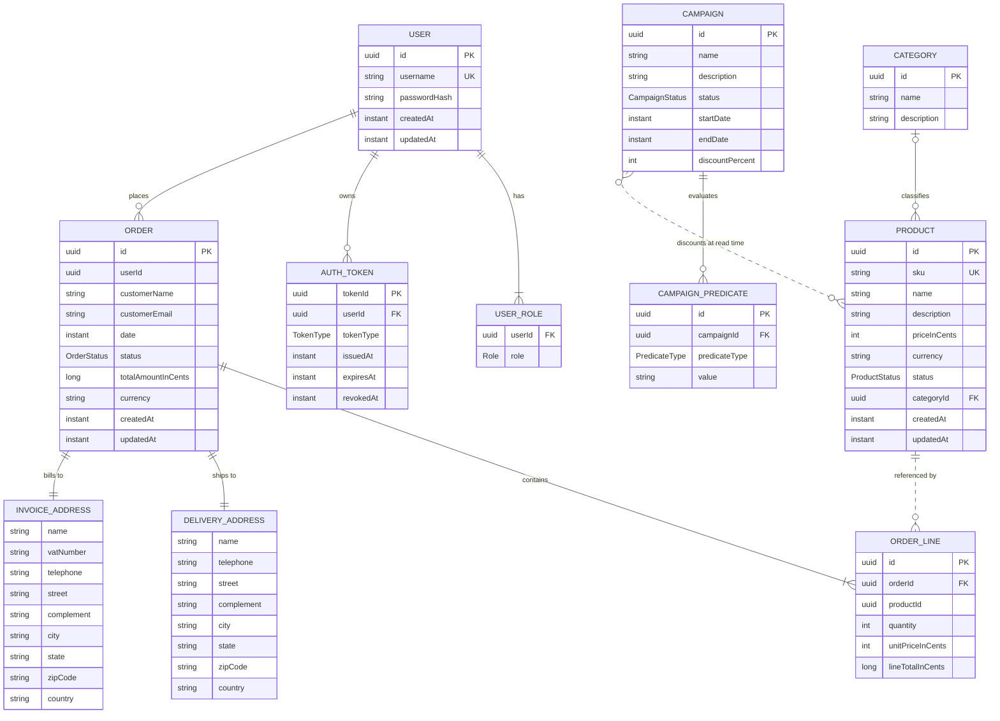
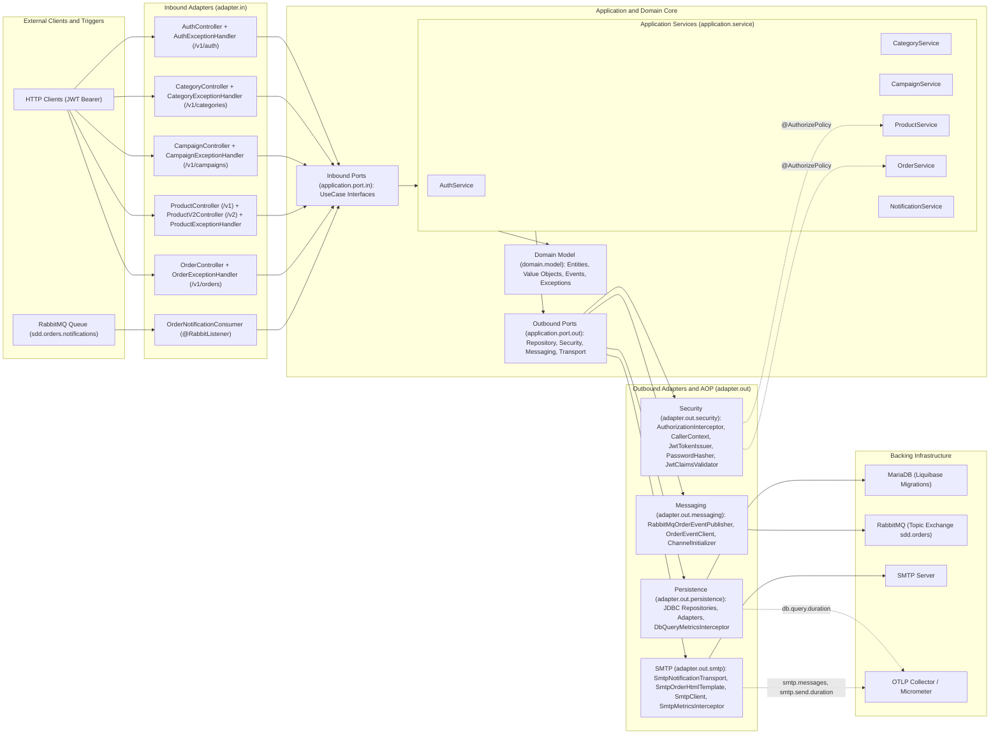
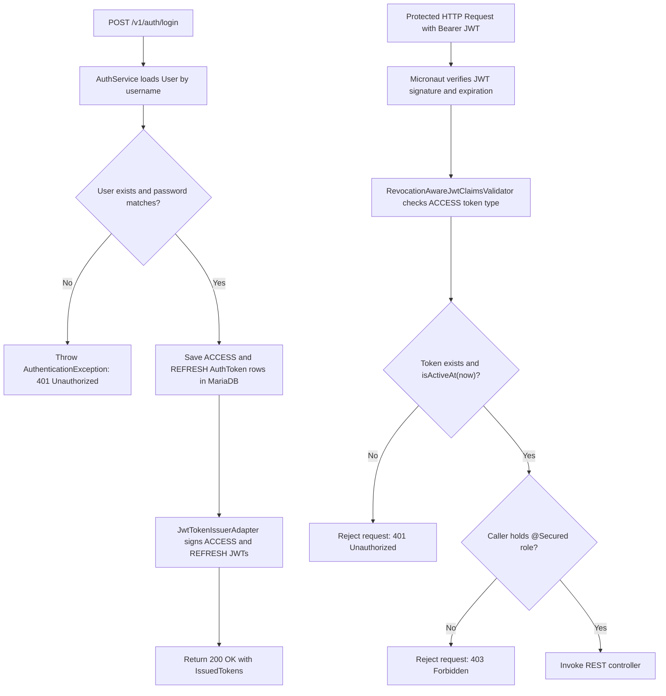
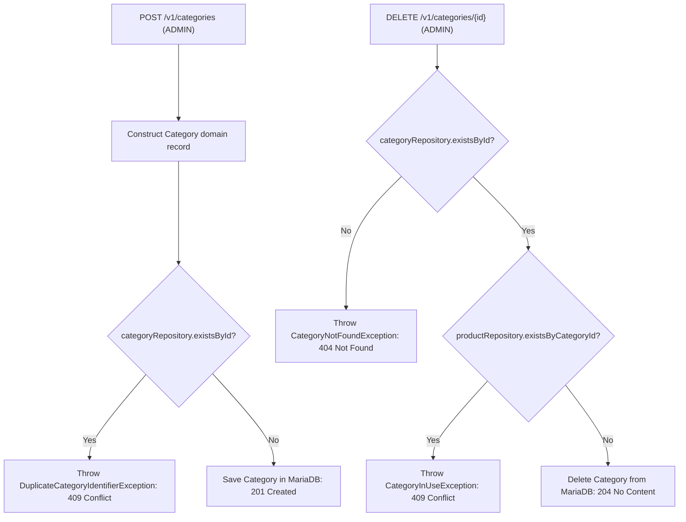
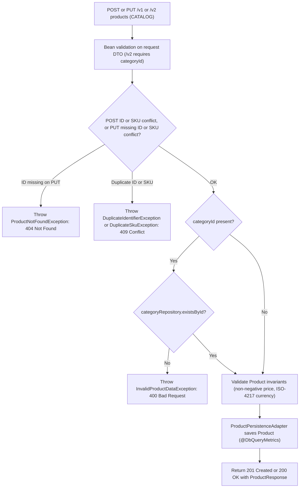
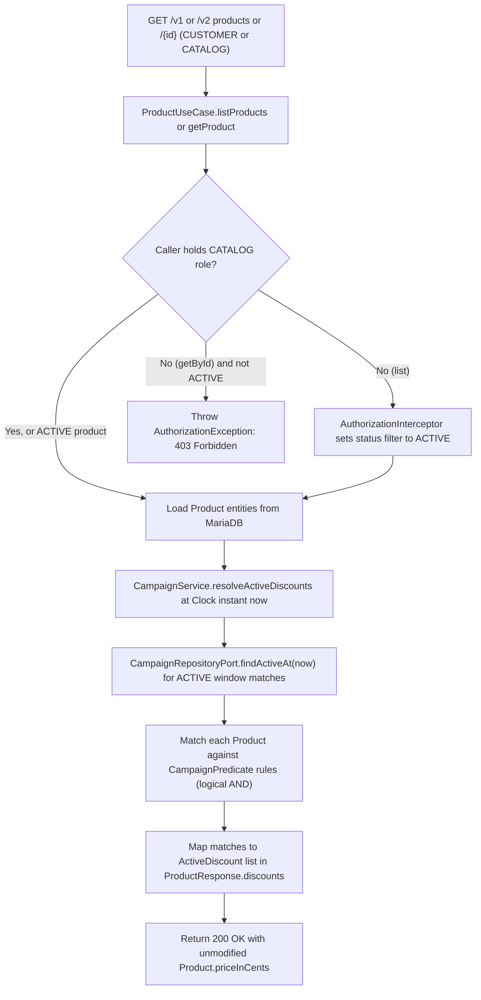
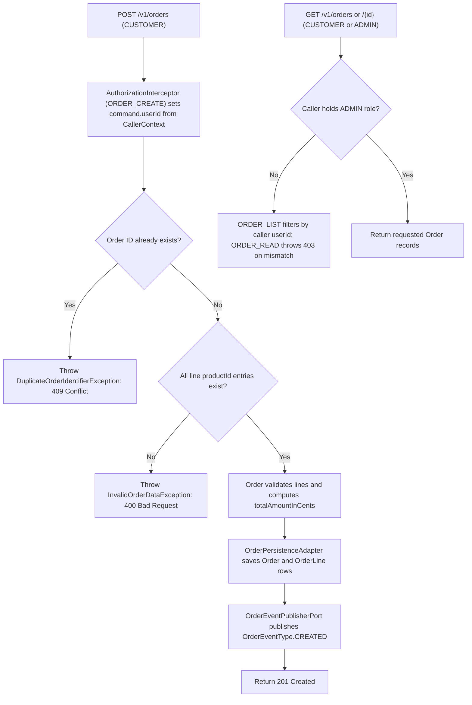

# Technical Design

This document describes the technical design of the `sdd-example` service.
It covers the domain model, the system components, and the main use case flows.

---

## 1. System Overview

This repository provides `sdd-example`, an e-commerce REST service that runs on Java 25 and Micronaut 5.2.5.
The service manages user authentication, product categories, products, promotional campaigns, orders, and asynchronous email notifications.

The architecture follows Hexagonal Architecture and Domain-Driven Design (DDD).
Pure business rules live in the domain package with zero framework dependencies.
Application services coordinate use cases through inbound and outbound ports.
Inbound adapters handle HTTP requests and RabbitMQ messages.
Outbound adapters handle MariaDB persistence, security, RabbitMQ publishing, and SMTP delivery.

---

## 2. Domain Model and Entity-Relation Diagram

The domain model resides in `es.nachobrito.sdd.example.domain.model` and uses immutable Java records with constructor invariant validation.

### 2.1 Entity-Relation Diagram

### 2.2 Domain Entities, Value Objects, and Enumerations

| Model Type | Kind | Key Invariants and Values |
|:---|:---|:---|
| `User` | Aggregate root | Non-blank unique `username` (max 100), non-blank `passwordHash`, and at least one `Role`. |
| `Role` | Enumeration | `ADMIN`, `CUSTOMER`, `CATALOG`. |
| `AuthToken` | Entity | Tracks `tokenId` (`jti`), `TokenType` (`ACCESS` or `REFRESH`), `expiresAt > issuedAt`, and `revokedAt`. |
| `Category` | Aggregate root | Non-blank `name` (max 255) and optional `description` (max 4000). |
| `Product` | Aggregate root | Unique `sku` (max 100), `priceInCents >= 0`, valid ISO-4217 `currency`, `ProductStatus`, and optional `categoryId`. |
| `ProductStatus` | Enumeration | `DRAFT`, `ACTIVE`, `ARCHIVED`. |
| `Campaign` | Aggregate root | `endDate >= startDate`, `discountPercent` from `0` to `100`, `CampaignStatus`, and `CampaignPredicate` list. |
| `CampaignStatus` | Enumeration | `DRAFT`, `ACTIVE`, `INACTIVE`. |
| `CampaignPredicate` | Value object | Evaluates `IN_CATEGORY`, `NOT_IN_CATEGORY` (UUID), `IS_CHEAPER_THAN`, or `IS_MORE_EXPENSIVE_THAN` (cents). |
| `ActiveDiscount` | Projection | Request-time record holding `campaignId`, `campaignName`, and `discountPercent` without modifying `Product`. |
| `Order` | Aggregate root | Owning `userId`, email format, `totalAmountInCents` equal to line sum, non-empty `OrderLine` list, and `OrderStatus`. |
| `OrderStatus` | Enumeration | `PENDING`, `PAID`, `SHIPPED`, `DELIVERED`, `CANCELLED`. |
| `OrderLine` | Value object | `quantity > 0`, `unitPriceInCents >= 0`, and `lineTotalInCents == quantity * unitPriceInCents`. |
| `DeliveryAddress`, `InvoiceAddress` | Value objects | Trimmed required address fields, optional `complement`, and `vatNumber` on `InvoiceAddress`. |
| `OrderLifecycleEvent` | Domain event | Carries `eventId`, `OrderEventType` (`CREATED`, `UPDATED`, `CANCELLED`), `timestamp`, and `Order`. |
| `NotificationMessage` | Value object | Validated `recipient` email, `subject` (max 200), `body`, and `NotificationChannel` (`SMTP`). |

### 2.3 Persistence Mapping Notes

- **Embedded addresses**: `OrderPersistenceAdapter` stores `DeliveryAddress` and `InvoiceAddress` fields directly in columns of the `orders` table.
- **Surrogate keys on child tables**: The `order_lines` and `campaign_predicates` tables include a UUID `id` primary key alongside their parent foreign keys.
- **Category deletion constraint**: The `products.category_id` column enforces a SQL foreign key to `categories.id` with `ON DELETE RESTRICT`.
- **Application-level references**: `orders.user_id` and `order_lines.product_id` use indexes without SQL foreign keys; `OrderService` validates `productId` existence at runtime.
- **Campaign matching**: `Campaign.matches` combines all `CampaignPredicate` entries with logical `AND` and matches all products when `predicates` is empty.
- **Role associations**: The `user_roles` table stores a composite primary key `(user_id, role)` with `ON DELETE CASCADE` on `users.id`.

---

## 3. Component Architecture

The codebase separates external interfaces from domain rules through explicit inbound and outbound port interfaces.
Cross-cutting security and observability concerns execute through Micronaut AOP method interceptors rather than inside business logic.

### Component Responsibilities

| Component Group | Package | Responsibility |
|:---|:---|:---|
| REST controllers and handlers | `adapter.in.rest` | Validate HTTP requests, enforce `@Secured` roles, call inbound ports, and map domain exceptions to HTTP status codes. |
| Messaging consumer | `adapter.in.messaging` | Consume `OrderEventDto` messages from `sdd.orders.notifications` and invoke `ProcessNotificationUseCase`. |
| Inbound ports | `application.port.in` | Define use case contracts and immutable command or query records. |
| Application services | `application.service` | Orchestrate transactions, domain validation, repository calls, discount resolution, and event publishing. |
| Domain model | `domain.model` | Enforce business invariants inside pure Java entities, value objects, domain events, and exception hierarchies. |
| Outbound ports | `application.port.out` | Abstract persistence, caller context, password hashing, JWT operations, event publishing, and notifications. |
| Security adapter and AOP | `adapter.out.security` | Issue and validate JWT tokens with revocation checks, hash passwords with PBKDF2, and enforce `@AuthorizePolicy` scoping. |
| Persistence adapters | `adapter.out.persistence` | Map domain models to Micronaut Data JDBC entities and record `db.query.duration` via `@DbQueryMetrics`. |
| Messaging publisher | `adapter.out.messaging` | Declare exchange `sdd.orders`, bind `sdd.orders.notifications`, and publish `order.*` events asynchronously. |
| SMTP transport | `adapter.out.smtp` | Render HTML emails with escaped fields, transmit messages via `SmtpClient`, and record `@SmtpMetrics`. |

---

## 4. Main Use Cases and Flow Diagrams

### 4.1 Authentication and Revocation-Aware JWT Validation

`AuthController` exposes `/v1/auth/register`, `/v1/auth/login`, `/v1/auth/validate`, `/v1/auth/refresh`, and `/v1/auth/revoke`.
Registration assigns `Role.CUSTOMER` and hashes passwords through `Pbkdf2PasswordHasher`.
Login issues both `ACCESS` and `REFRESH` tokens and stores their `tokenId` values in `auth_tokens`.
On every secured HTTP request, `RevocationAwareJwtClaimsValidator` checks the database to verify an active and unrevoked `ACCESS` token.

Token refresh (`POST /v1/auth/refresh`) validates an active `REFRESH` token, revokes that token in MariaDB, and issues a fresh token pair.
Token revocation (`POST /v1/auth/revoke`) marks the presented token as revoked immediately.

---

### 4.2 Category Management and Deletion Protection

`CategoryController` restricts `POST /v1/categories` and `DELETE /v1/categories/{id}` to `ADMIN` users, and restricts `GET /v1/categories` to `CUSTOMER` or `CATALOG` users.
The seeded `admin` account in Liquibase holds the `ADMIN`, `CUSTOMER`, and `CATALOG` roles.
`CategoryService` prevents deletion when any product references the target category.

---

### 4.3 Product Creation and Update (`/v1/products` and `/v2/products`)

Catalog managers (`CATALOG` role) create, update, and delete products through versioned endpoints.
`ProductController` (`/v1/products`) keeps `categoryId` optional for backward compatibility.
`ProductV2Controller` (`/v2/products`) requires `categoryId` on the request DTO.

---

### 4.4 Product Reads, AOP Visibility Scoping, and Request-Time Discounts

Both `/v1/products` and `/v2/products` expose `GET` and `GET /{id}` to callers holding `CUSTOMER` or `CATALOG` roles.
Before returning `ProductResponse`, the controller calls `ResolveProductDiscountsUseCase` to evaluate active campaigns at request time without storing discounts on `Product`.

`CampaignController` (`/v1/campaigns`) exposes `POST`, `PUT /{id}`, `GET`, and `DELETE /{id}` operations for `ADMIN` users so catalog reads reflect campaign changes immediately.

---

### 4.5 Order Management and AOP Ownership Scoping

Customers (`CUSTOMER` role) create orders through `POST /v1/orders` and read their own orders through `GET /v1/orders` and `GET /v1/orders/{id}`.
Administrators (`ADMIN` role) read all orders and perform updates (`PUT /v1/orders/{id}`) or deletions (`DELETE /v1/orders/{id}`).

On `PUT /v1/orders/{id}`, `OrderService` validates product IDs, updates the order, and publishes `OrderEventType.CANCELLED` for cancelled orders or `OrderEventType.UPDATED` otherwise.
On `DELETE /v1/orders/{id}`, `OrderService` rejects statuses other than `PENDING` or `CANCELLED` with `409 Conflict`, deletes the order, and publishes `OrderEventType.CANCELLED`.

---

### 4.6 Asynchronous Order Notification Pipeline

Order write operations publish lifecycle events to RabbitMQ instead of sending emails synchronously during HTTP requests.
`RabbitMqChannelInitializer` declares a durable topic exchange `sdd.orders`, declares a durable queue `sdd.orders.notifications`, and binds them with key `order.*`.

```mermaid
flowchart LR
    OrderSvc["OrderService"] -->|"publishOrderCreated / Updated / Cancelled"| Publisher["RabbitMqOrderEventPublisher"]
    Publisher -->|"OrderEventDto and routing key order.*"| Client["OrderEventClient (@RabbitClient)"]
    Client -->|"Publish to sdd.orders"| Exchange["RabbitMQ Topic Exchange (sdd.orders)"]
    Exchange -->|"Binding order.*"| Queue["Queue (sdd.orders.notifications)"]
    Queue --> Consumer["OrderNotificationConsumer (@RabbitListener)"]
    Consumer -->|"OrderLifecycleEvent"| NotifSvc["NotificationService"]
    NotifSvc --> Transport["SmtpNotificationTransport"]
    Transport --> Template["SmtpOrderHtmlTemplate renders escaped HTML"]
    Template --> Smtp["SmtpClient (@SmtpMetrics) sends email to SMTP server"]
```

`SmtpNotificationTransport` constructs a validated `NotificationMessage` with `NotificationChannel.SMTP`.
`SmtpMetricsInterceptor` wraps `SmtpClient.sendEmail` to record `smtp.messages` counters and `smtp.send.duration` timers with the `sent` or `failed` outcome tag.
`NotificationService` logs transport failures without stopping the consumer loop so failed deliveries do not block subsequent messages.
